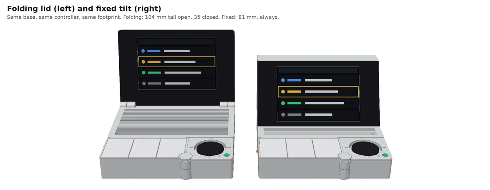
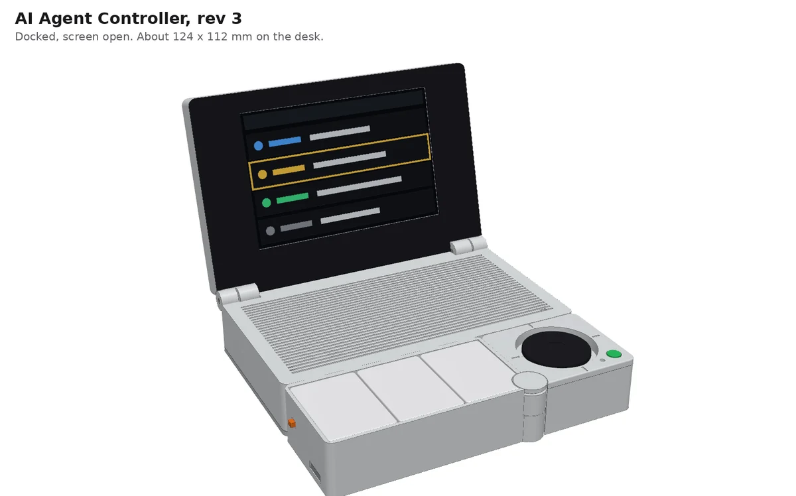
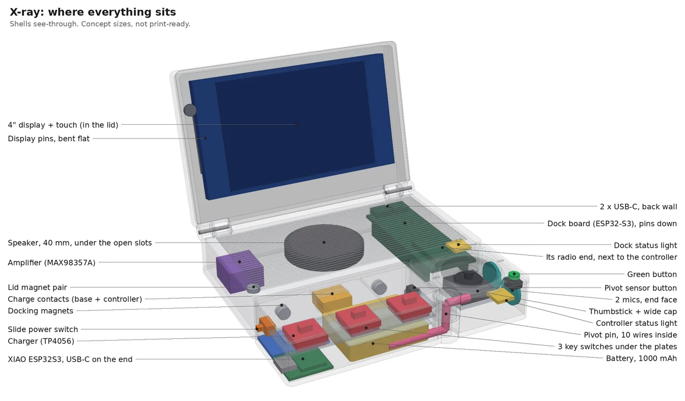
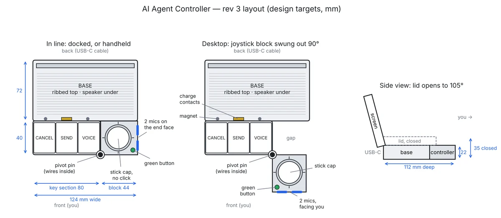
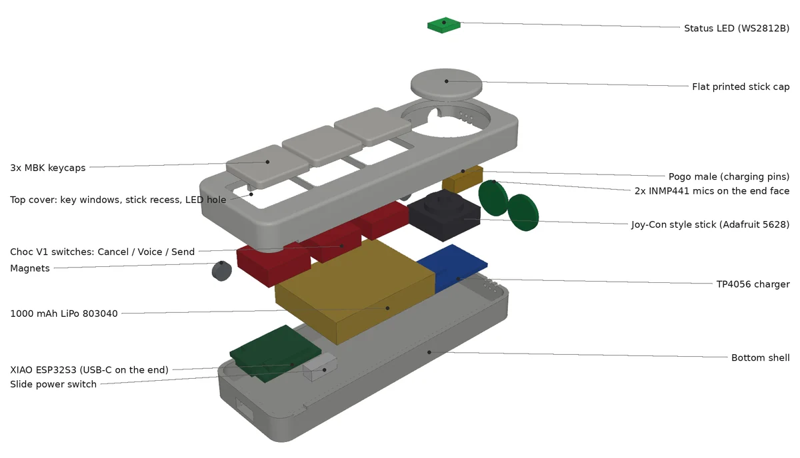

# Build log — AI Agent Controller

Newest first. Each entry covers what changed, why, and links to its renders and docs.

---

## 2026-11-26 — First firmware on the dock board (M4 bench start)
- Plugged the dock board (ESP32-S3 DevKitC-1 N16R8) into the Mac Mini and flashed a hello sketch that reports what the chip really has. → [sketch](firmware/bench/dock_hello/dock_hello.ino)
- **It passes:** 16 MB flash and 8 MB PSRAM, as ordered. A 4 MB PSRAM write/read check passed, and `esptool` read 16 MB from the flash chip itself.
- Chip: ESP32-S3 rev 2, 2 cores, 240 MHz.
- Toolchain on the Mac Mini: `arduino-cli` 1.6.0 with the Espressif ESP32 core 4.0.0. Board settings: Flash Size = 16 MB, PSRAM = OPI PSRAM.
- The dock board came with its pins soldered. The second ESP32-S3 board (the controller stand-in) came without pins; its headers need soldering before the controller work (M5).
- Next: the display.

## 2026-11-18 — Option: a fixed-tilt screen (rev 3b)
- Mocked up a version where the screen never folds: it sits in a rigid wedge at 60°. Same base, same controller, same footprint. → [comparison](docs/option-fixed-tilt.md), [renders](hardware/renders/2026-11-18-rev3b-fixed-tilt/)
- It removes the hinge, the wires that flex across it, the lid magnets and the pin bending. It gives up closing flat.
- Not chosen. The folding lid stays the plan.

## 2026-11-18 — Rev 3 concept model: the finished look and an x-ray
- Built the whole device as a 3D model with every part in its place. → [renders](hardware/renders/2026-11-18-rev3-concept/)
- Eight views: open, block swung out, controller off the dock, closed, two x-ray views, and both halves exploded with labels.
- The model checks itself: no two parts overlap, with the lid closed, the block in line, and the block swung out.
- It found five tight spots, listed in [blueprint §4.7](docs/agent-controller-v0-blueprint.md). The main one: the display's pins were taller than the room behind it in the lid.
- **Decision:** the lid grows from 10 to 13 mm and the display's pins are bent flat. The device is about 35 mm tall when closed.

## 2026-11-18 — Rev 3: plan and blueprint rebuilt from the reference
- Went back through every photo in the chat and everything public about SlashVibe: the site, the Kickstarter page, its FAQ, updates and comments, four demo videos and the press coverage. → [reference notes](docs/research/slashvibe-reference.md)
- **The joystick block pivots.** It swings out 90° so your thumb rests on the stick while your fingers stay on the keys. The earlier notes said it didn't; Nico's photo shows it does.
- Other corrections:
  - The key order is Cancel / Send / Voice.
  - The keys are large plates.
  - The stick has no click.
  - There is a small green button on the block.
  - The dock has four contacts.
- New [complete plan](docs/plan.md) and [blueprint rev 3](docs/agent-controller-v0-blueprint.md): the pivot on a hollow pin, hinged key plates, position sensing so stick directions are always right, and a controller that only talks to the dock.
- Nothing already bought is wasted. One new part: small tactile buttons.

- **Shopping list:** [what to buy now](hardware/bom/shopping-list-2026-11-18.md). A second audit of the build steps added six things earlier lists missed: battery lead connectors, a capacitor kit, a full jumper kit, a USB-C power meter, extra breadboards, and a second data cable.

## 2026-11-11 — Fixes from the Mac Mini test
- **Silent when the app is off.** Every Claude Code hook now runs a small script instead of Claude Code's built-in web hook. When the companion app isn't running, nothing shows in Claude Code. Checked live: 0 error lines.
- **Answer in either place.** Claude Code shows its own permission menu at the same time as the device. If you answer in the terminal, the device now clears the question as soon as the session moves on, instead of 2 minutes later.
- **"Approve for session" never changes Claude Code's mode.** It only adds the permission rule, for this session only.
- Status updates run in the background, so Claude Code never waits for the companion app. Late arrivals are put back in order.
- 54 automated tests.
- **Rechecked on the Mac Mini:** all three fixes work there.

## 2026-11-11 — M1 tested on the Mac Mini
- Ran the full Mac Mini test with a real Claude Code session, the companion app and the fake device in three Terminal windows.
- **Works:** live status and LED; Approve (Claude Code's own menu closes by itself and shows "Allowed by PermissionRequest hook"); Reject (Claude doesn't retry); Ask in terminal (the normal prompt answers as usual); Send brings the session's window to the front with no macOS permission prompt; a direct curl to the hook server.
- **Three issues found** (being fixed in a separate session):
  1. "Approve for session" also switched Claude Code to "accept edits on", because it applied every suggestion Claude Code offered, including a mode change.
  2. In interactive mode Claude Code shows its own permission menu while our hook waits, and the first answer wins. Answering in the terminal leaves a stale Approval screen on the device for 2 minutes.
  3. With the companion app off, Claude Code still works but prints `hook error: connect ECONNREFUSED 127.0.0.1:8766` on most events.
- Fixed a test that failed every time on the M4: it checked the LED a moment before the device had received it.

## 2026-11-11 — M1: Claude Code approvals from the device
- **First live approval.** A real Claude Code session asked for permission to run a Bash command. The fake device showed the Approval screen, one press of Approve let it run, and the command wrote its file.
- Claude Code status flows in through its hooks: working (with the current tool), waiting, done, error. The app sends them to a local hook server on `127.0.0.1:8766`.
- Approvals use the `PermissionRequest` hook. The options are Approve / Approve for session / Reject / Ask in terminal. If the device is off, you don't answer within 120 s, or Claude Code hangs up, it falls back to the normal terminal prompt.
- `python -m companion install-hooks` / `uninstall-hooks` edit `~/.claude/settings.json`. They back the file up first and never touch your other hooks. `doctor` checks the setup.
- Send on Home/Detail brings that session's terminal tab to the front (macOS: Terminal and iTerm2 by tab, other apps by name). Not tested on the Mac yet.
- The v0 `main.py` became `platforms/claude_code/managed.py`, and it no longer skips permissions.
- 45 automated tests, including every approval path end to end.

## 2026-11-11 — M0: companion app restructure + fake device
- The companion app is now a proper package (`software/companion-app/companion/`). It has protocol v1, a Wi-Fi WebSocket transport, the state store, the key map for every screen, and a view builder that sends the dock only what changed.
- USB packet framing (COBS) is written and tested now, so Path B only needs the serial port code when the dock arrives.
- `tools/fake_device.py` is a terminal stand-in for the dock + controller. It speaks the same protocol the real hardware will: arrow keys = stick, `c` / `v` / `s` = Cancel / Voice / Send.
- 28 automated tests cover the protocol, framing, screens, the handshake, heartbeat timeout, and duplicate-press protection.
- Added [HANDOFF.md](HANDOFF.md), updated after every step, so the plan survives any chat reset.

## 2026-11-11 — Code architecture
- Wrote the [software architecture](docs/architecture.md): three programs (companion app, dock firmware, controller firmware), one protocol over USB, Wi-Fi and ESP-NOW, screen-by-screen button map, voice pipeline, and platform plug-in contract.
- Claude Code approvals will use its HTTP `PermissionRequest` hook. The companion app holds the request until you press a key; if the device is off, Claude Code falls back to its normal prompt.
- Build order puts four milestones (fake device, Claude Code plug-in, voice on the Mac mic, UI simulator) before any hardware arrives.

## 2026-11-11 — Rev 2 locked: dock + detachable controller
- Studied SlashVibe's live Kickstarter: its controller is one rigid bar (3 keys and a stick at one end) that charges through magnetic contacts on the dock. We copied that layout. → [research notes](docs/research/slashvibe-reference.md)
- Added a **USB data path** (dock native USB, controller → dock over ESP-NOW) next to Wi-Fi. Both get built and timed head to head.
- Planned our own voice pipeline: local Whisper on the M4, Claude cleanup, a personal dictionary, Send/Cancel.
- Planned platform plug-ins: Claude Code first (hooks for status and approvals), then Cursor, the chat apps, and the cloud agents.
- Fixed the rev 1 pin map: I2S was on GPIO35–37, which the N16R8's octal PSRAM uses.
- Organized the repo as a physical-product project: a [BOM](hardware/bom/BOM.csv) with order status, a [decision log](docs/decisions.md), and folders for wiring, printing, firmware, tests and web images.
- Concept model and renders of rev 2, with no part collisions. → [renders](hardware/renders/2026-11-11-rev2-dock-controller/) · [CAD script](hardware/cad/rev2-dock-controller/concept.py) · [blueprint rev 2](docs/agent-controller-v0-blueprint.md)

## 2026-11-09 — Rev 1 clamshell shell, then the pivot
- Wrote a parametric CadQuery clamshell. It checks fit automatically: part overlaps, how far the lid swings (137°), and joystick tilt clearance. → [renders](hardware/renders/2026-11-09-rev1-clamshell/) · [CAD script](hardware/cad/rev1-clamshell/shell.py)
- The checks showed the PS2 joystick forced a 24 mm-thick base. Swapped it for a low-profile Joy-Con-style stick.
- Decided to drop the clamshell for a desk dock with a detachable controller, closer to the final v1.

## 2026-11-08 — Companion app works end to end; parts ordered
- The Python companion app receives a task over WebSocket, runs Claude Code, and streams tool and done events back. Tested on Windows.
- Parts ordered from AliExpress, keeb.io and Amazon; soldering station and multimeter for the bench.
- Created this repo.

## 2026-11-07 — Spec
- First spec: a physical controller for AI coding agents, inspired by SlashVibe. → [spec (superseded)](docs/agent-controller-v0-spec.md)
