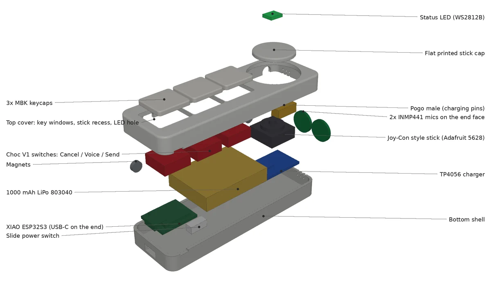

# Build log — AI Agent Controller

Newest first. Each entry covers what changed, why, and links to its renders and docs.

---

## 2026-11-11 — Rev 2 locked: dock + detachable controller
- Studied SlashVibe's live Kickstarter: its controller is one rigid bar (3 keys and a stick at one end) that charges through magnetic contacts on the dock. We copied that layout. → [research notes](docs/research/slashvibe-reference.md)
- Added a **USB data path** (dock native USB, controller → dock over ESP-NOW) next to Wi-Fi. Both get built and timed head to head.
- Planned our own voice pipeline: local Whisper on the M4, Claude cleanup, a personal dictionary, Send/Cancel.
- Planned platform plug-ins: Claude Code first (hooks for status and approvals), then Cursor, the chat apps, and the cloud agents.
- Fixed the rev 1 pin map: I2S was on GPIO35–37, which the N16R8's octal PSRAM uses.
- Organized the repo as a physical-product project: a [BOM](hardware/bom/BOM.csv) with order status, a [decision log](docs/decisions.md), and folders for wiring, printing, firmware, tests and web images.
- Concept model and renders of rev 2, with no part collisions. → [renders](hardware/renders/2026-11-11-rev2-dock-controller/) · [CAD script](hardware/cad/rev2-dock-controller/concept.py) · [blueprint rev 2](docs/agent-controller-v0-blueprint.md)

## 2026-11-09 — Rev 1 clamshell shell, then the pivot
- Wrote a parametric CadQuery clamshell. It checks fit automatically: part overlaps, how far the lid swings (137°), and joystick tilt clearance. → [renders](hardware/renders/2026-11-09-rev1-clamshell/) · [CAD script](hardware/cad/rev1-clamshell/shell.py)
- The checks showed the PS2 joystick forced a 24 mm-thick base. Swapped it for a low-profile Joy-Con-style stick.
- Decided to drop the clamshell for a desk dock with a detachable controller, closer to the final v1.

## 2026-11-08 — Companion app works end to end; parts ordered
- The Python companion app receives a task over WebSocket, runs Claude Code, and streams tool and done events back. Tested on Windows.
- Parts ordered from AliExpress, keeb.io and Amazon; soldering station and multimeter for the bench.
- Created this repo.

## 2026-11-07 — Spec
- First spec: a physical controller for AI coding agents, inspired by SlashVibe. → [spec (superseded)](docs/agent-controller-v0-spec.md)
