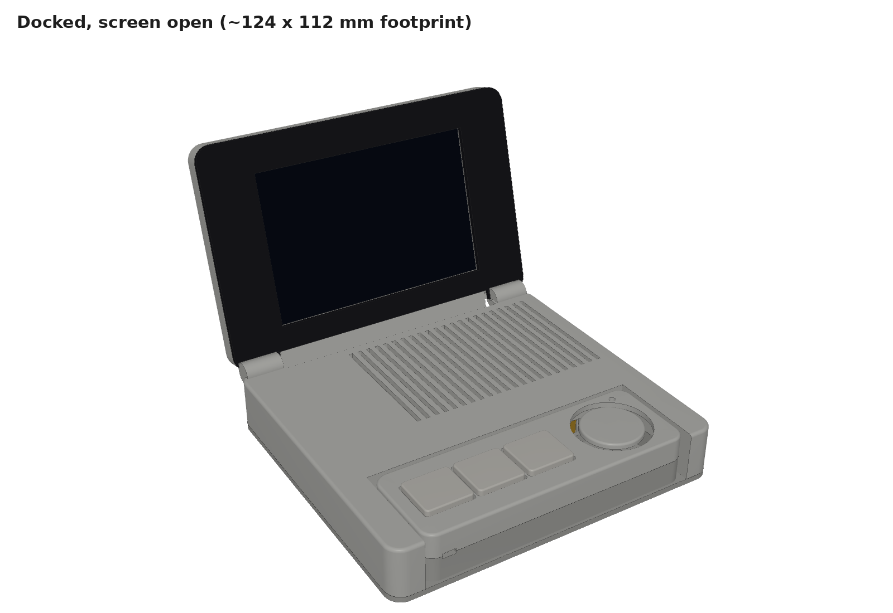

# AI Agent Controller

A desk dock with a 4" screen plus a detachable controller with keys, a thumbstick and mics. It lets you watch, approve and talk to AI coding agents (Claude Code first) without switching windows. A Python companion app on the computer bridges it to your tools over USB or Wi-Fi. Inspired by SlashVibe.

### Status
- Companion app: working (v0). Claude Code task in → tool and done events out.
- Hardware: parts arriving; design rev 2 (dock + detachable controller) locked as a concept. Print CAD waits for caliper measurements.
- Firmware: not started.
- Voice pipeline and platform plug-ins: planned (see blueprint).

### Follow along
- **[Build log](BUILDLOG.md)**: dated entries, newest first
- **[Renders](hardware/renders/)**: one folder per design revision

### Files
| Path | What |
|---|---|
| `companion-app/main.py` | Python companion app (WebSocket server + Claude Code subprocess) |
| `docs/agent-controller-v0-blueprint.md` | Rev 2: parts, pin maps, USB + Wi-Fi architecture, voice pipeline, platform plug-ins, build and test plan |
| `docs/research/slashvibe-reference.md` | Notes on the reference product |
| `docs/agent-controller-v0-spec.md` | Original clamshell spec (superseded) |
| `hardware/cad/` | Parametric CadQuery scripts, one folder per revision (outputs are git-ignored; rerun to regenerate) |
| `hardware/renders/` | Renders, one dated folder per revision |
| `media/photos/` | Bench and build photos (`YYYY-MM-DD-what.jpg`) |
| `showcase.json` | Machine-readable summary (title, status, hero image, timeline) for the portfolio site |
