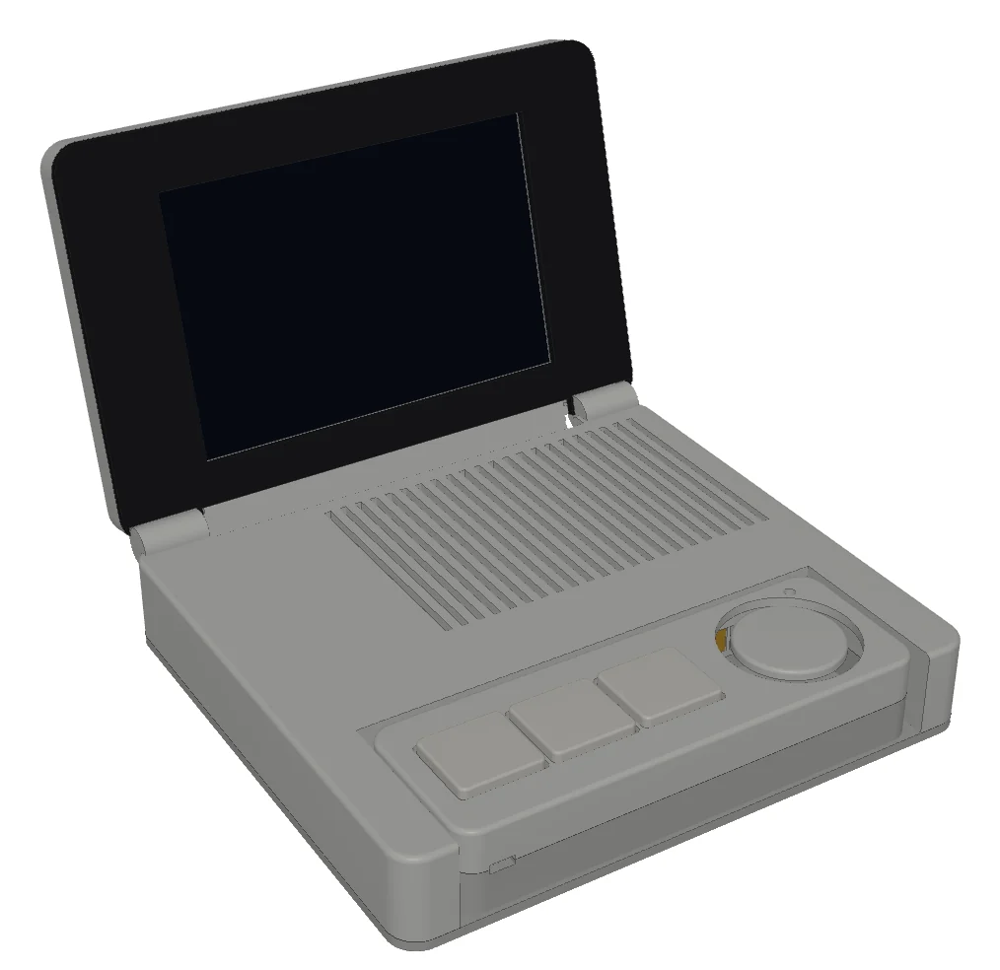

# AI Agent Controller

A desk dock with a 4" screen plus a detachable controller with keys, a thumbstick and mics. It lets you watch, approve and talk to AI coding agents (Claude Code first) without switching windows. A Python companion app on the computer bridges it to your tools over USB or Wi-Fi. Inspired by SlashVibe.



## Status: in build

| Area | State |
|---|---|
| Design | Rev 2 (dock + detachable controller) locked as a concept. Print CAD waits for caliper measurements. |
| Parts | Mostly ordered. See [BOM](hardware/bom/BOM.csv). |
| Companion app | v0 working: a Claude Code task goes in, tool and done events come out |
| Software architecture | Written ([architecture](docs/architecture.md)); milestones M0–M3 need no hardware |
| Firmware | Not started |
| Voice pipeline, platform plug-ins | Planned ([blueprint](docs/agent-controller-v0-blueprint.md) §6–7) |

**Picking the project up?** Start with the [handoff](HANDOFF.md): current step, next step, rules and key facts.

**Follow along:** [Build log](BUILDLOG.md) · [Renders](hardware/renders/) · [Decision log](docs/decisions.md) · [Software architecture](docs/architecture.md)

## Layout

```
agent-controller/
├── README.md              this page
├── HANDOFF.md             where we are, what's next, rules — updated after every step
├── BUILDLOG.md            dated progress entries, newest first
├── showcase.json          short summary for the portfolio site (nicorudu.com)
├── docs/
│   ├── agent-controller-v0-blueprint.md   the plan: parts, pins, architecture, voice, plug-ins, tests
│   ├── architecture.md                     how the code is organized and built
│   ├── decisions.md                        every design decision and why
│   ├── research/slashvibe-reference.md     notes on the reference product
│   └── agent-controller-v0-spec.md         original clamshell spec (superseded)
├── hardware/
│   ├── bom/BOM.csv        every part: spec, supplier, order status
│   ├── wiring/            wiring diagrams and harness photos (pin maps live in the blueprint)
│   ├── cad/<rev>/         parametric CadQuery scripts, one folder per revision
│   ├── renders/<date>-<rev>/   renders from those scripts, never overwritten
│   └── print/             print settings and a per-part print log
├── firmware/              dock + controller firmware (planned)
├── software/companion-app/   Python app on the Mac / PC
├── tests/                 test results, including the USB vs Wi-Fi shoot-out
└── media/
    ├── photos/            real build photos, YYYY-MM-DD-what.jpg
    └── web/               small WebP versions for the website and social posts
```

## Conventions
- **Dates** are `YYYY-MM-DD` in every file and folder name, so they sort in order.
- **Revisions:** a new design revision gets new folders (`cad/revN-…`, `renders/<date>-revN-…`). Old ones stay as history.
- **Parts** are referred to by their BOM ID (`D2`, `C5` …).
- **Generated files** (STL, STEP, CAD output) are not committed. Rerun the script, or attach finished print sets to a GitHub Release.
- **Every milestone** gets a build log entry, a decision log line if something changed, and fresh `media/web/` images if the look changed. Then update `showcase.json` so the website stays current.
