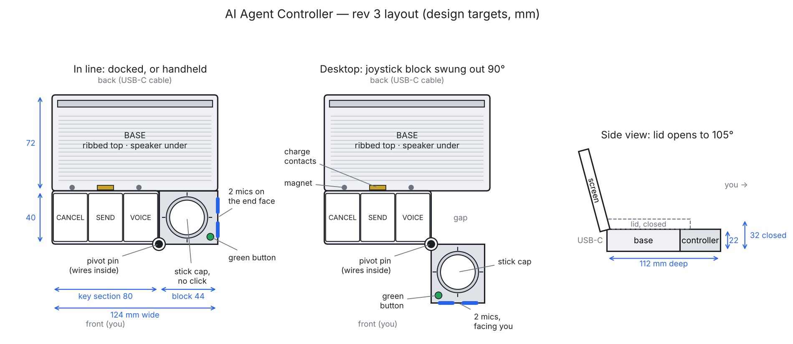

# AI Agent Controller — v0 blueprint (rev 3)

Written 2026-11-18. It replaces rev 2 (Nov 11). Rev 3 follows a full re-check of the reference product: [research/slashvibe-reference.md](research/slashvibe-reference.md).

- The plan, milestones and shopping checks: [plan.md](plan.md)
- How the code is organized: [architecture.md](architecture.md)
- Parts with order status: [../hardware/bom/BOM.csv](../hardware/bom/BOM.csv)

### What changed from rev 2
| Rev 2 | Rev 3 |
|---|---|
| Rigid controller bar; "the stick does not swivel" | **The joystick block pivots 90°** on a hollow pin |
| Keys: Cancel / Voice / Send | Keys: **Cancel / Send / Voice**, with Voice beside the joystick |
| 1u keyboard keycaps | **Large printed key plates**, about 25 × 36 mm |
| Stick click opens and confirms | **Click not used.** Right opens, left goes back, Send confirms. |
| Status LED beside the stick | **Green button** on the block, with the status LED in a small window beside it |
| Controller lies in a tray on the dock | Controller **attaches to the base's front face**; no tray |
| Controller can talk to the Mac directly over Wi-Fi | Controller **always** talks to the dock (ESP-NOW). Only the dock talks to the Mac. |
| No position sensing | The controller knows whether the block is **swung out** and whether it is **docked**, so stick directions always match what you see |
| Home: left/right changes a filter | Home: right opens the detail page; no filters |

Sizes in this document are **design targets**. Nothing is printed until the real parts are measured (plan, milestone M7a).

---

## 1. What we're building

Three bodies, like the reference:

- **Lid:** the 4.0" screen in a frame. It hinges at the back of the base and folds flat.
- **Base:** a low box with a ribbed top over the speaker. One USB-C cable leaves from the back and carries power and data.
- **Controller:** sits in front of the base, the same width and height. It is held on by magnets and charges through two spring contacts.
  - **Key section:** three large key plates, **Cancel / Send / Voice**.
  - **Joystick block:** a wide flat stick cap in a round dish, the green button, and two mics on the end face.
  - The block pivots 90° at the front corner of the joint.



Three ways to use the controller:

| Position | How | Stick "up" means |
|---|---|---|
| Docked, in line | The compact shape; reach forward | Away from you |
| Desktop, block swung out | Docked or detached; fingers on keys, thumb on stick | Away from you |
| Handheld, in line | Held upright like a remote; mics near your mouth | Toward the top end |

```
TOP VIEW, in line (docked)                      TOP VIEW, block swung out

              back                                            back
 ┌─────────────────────────────────────┐        ┌─────────────────────────────────────┐
 │ ═══════════ lid hinge ═══════════   │        │ ═══════════ lid hinge ═══════════   │
 │                                     │        │                                     │
 │   BASE  124 × 72                    │        │   BASE                              │
 │   ribbed top, speaker underneath    │        │                                     │
 ├────────[magnet][contacts][magnet]───┤        ├────────[magnet][contacts][magnet]───┤
 │ CANCEL │  SEND  │ VOICE │  (stick)  │mics    │ CANCEL │  SEND  │ VOICE │    gap
 │   key section 80 × 40  │ block 44×40│        └────────────────────────●───────┐
 └────────────────────────●────────────┘                                 │(stick)│
              front (you)        ● = pivot                               │  mics │ ← face you
                                                                         └───────┘
```

---

## 2. System

```
        Mac Mini / Windows laptop — companion app (Python)
        sessions · approvals · voice · screens
              ▲                         ▲
   Link B     │ USB (default)           │ Wi-Fi WebSocket      Link A (for comparison)
              │                         │
        ┌─────┴─────────────────────────┴─────┐
        │ DOCK  ESP32-S3 N16R8 DevKitC-1      │
        │ 4" screen + touch · amp + speaker   │
        │ LED · 5 V out on two contacts       │
        └───────▲──────────────────┬──────────┘
        ESP-NOW │ 2.4 GHz          │ 5 V charge (when docked)
        ┌───────┴──────────────────▼──────────┐
        │ CONTROLLER  XIAO ESP32S3            │
        │ 3 keys · stick · green button · LED │
        │ 2 mics · 1000 mAh · charger         │
        └─────────────────────────────────────┘
```

- **Thin client.** The companion app does all the work. The dock draws what it's told and passes input along.
- **One radio hop.** The controller only talks to the dock. Its radio sleeps between presses, which is what makes a workday of battery possible.
- **Two computer links, same messages.** USB is the default, as on the reference. Wi-Fi is built too, and the two are timed head to head (M6).

---

## 3. Parts

BOM IDs in brackets. Order status is in the BOM, not here.

**Lid and base (dock)**
- ESP32-S3-DevKitC-1 N16R8, pins soldered [D1]
- 4.0" ST7796S 320 × 480 SPI display with FT6336U touch, used in landscape [D2]
- MAX98357A I2S amplifier [D3]
- 40 mm, 4 Ω, 2 W speaker, 5 mm thick [D4]
- WS2812B LED [D5]
- Magnetic 2-pin spring connector, the half without pins [D6]
- 6 × 2 mm magnets [D7]

**Controller**
- Seeed XIAO ESP32S3, plain [C1]
- Adafruit #5628 Joy-Con-style thumbstick. Its click is left unconnected. [C2]
- 3 × Kailh Choc V1 Red switches [C3]
- 2 × INMP441 I2S mics [C5]
- LiPo 3.7 V 1000 mAh, 8 × 30 × 40 mm [C6]
- TP4056 USB-C charger with protection [C7]
- SS12D00G3 slide switch [C8]
- Resistors: 2 × 100 kΩ, 1 × 150 kΩ, 1 × 10 kΩ, 1 × 22 kΩ [C9]
- 2 × 6 × 6 mm tactile buttons: the green button and the pivot sensor [C10, new]
- JST-PH 2.0 mm pigtail, so the battery plugs into the charger [C11, new]
- 1 × 0.1 µF ceramic capacitor on the battery-reading pin [C12, new]
- WS2812B LED [D5], the spring connector's pin half [D6], magnets [D7]

**Printed:** lid frame, base, base bottom plate, key section, joystick block, three key plates, stick cap, green button cap, pivot pin and retainer.

**Not used:** the plain 1u keycaps [C4] stay on the breadboard only; items X1–X6 stay spares.

---

## 4. Mechanical design

### 4.1 Target sizes (mm)

| Body | Width × depth × height | Notes |
|---|---|---|
| Base | 124 × 72 × 22 | Height is set by the dev board with its soldered pins |
| Controller | 124 × 40 × 22 | Flush with the base top. May grow to 24 (see 4.5). |
| Key section | 80 × 40 | Left part of the controller |
| Joystick block | 44 × 40 | Right part |
| Lid | 124 × 82 × 10 | Overhangs the controller by 10 when closed |
| Whole device, closed | about 124 × 112 × 32 | Reference: 105 × 89 × 21 |
| Whole device, open | Lid stops at 105° | |

### 4.2 Base
- **Top:** printed ribs running left to right, 2 mm pitch. Open slots over the speaker only; the rest are blind grooves.
- **Speaker:** face up under the slots, on a foam-tape gasket.
- **Dev board:** along one side with both USB-C ports at the back wall. The cable goes to the port marked **USB**.
- **Front face:** the connector half without pins, centered on the key section, with one magnet 25 mm to each side of it. A 1 mm tongue helps the controller line up. The part of the face behind the joystick block is plain.
- **Bottom:** a removable plate on four M2 screws into heat-set inserts. Stick-on feet.

### 4.3 Lid and hinge
- A frame around the display module with the screen in landscape.
- **Hinge:** two knuckles at the back corners with M2 screws as pins. A printed stop holds the lid at 105°. One magnet pair holds it shut.
- **Wires:** 11 or 12 wires (display, touch, power) cross beside the hinge through a slot, with a slack loop inside the base.

### 4.4 Joystick block and pivot
- **Pivot axis:** vertical, at the **front corner** of the joint between the key section and the block.
- **Pivot pin:** a hollow printed pin, 9.5 mm outside and 6 mm bore. It is part of the key section. The block has a matching ear and is held on by a printed retainer and one M2 screw.
- **Wires:** ten wires run up through the bore (see §5.3), with a slack loop on each side.
- **In-line position:** a magnet pair in the joint faces pulls the block shut. This is what keeps the controller rigid in the hand.
- **Swung-out position:** a printed bump clicks into a notch at 90°, and a hard stop prevents over-rotation.
- **Pivot sensor:** a tactile button in the key section's end wall. The block presses it when in line.
- **Top face:**
  - A 31 mm dish with a 26 mm stick cap, flat and wide with a dimpled center.
  - Four tick marks.
  - The green button at the front outer corner, with a 2 mm light window beside it for the status LED.
- **End face:** two oval grilles. One mic sits behind each, with a foam gasket.
- **Stick cap:** press-fits on the thumbstick's nub. The dish leaves a few millimetres under the cap's edge, because this stick tilts where the reference's slides.

### 4.5 Key section
- **Key plates:** three plates, 25.5 × 36 mm, with 0.8 mm gaps and icons recessed into the print.
  - Each plate **hinges at its rear edge** and presses its switch like a lever. A large plate pushed off-center on a single switch would tilt and bind otherwise.
  - If the M7b test print shows it isn't needed, the plates clip straight onto the switch stems.
- **Under the plates:** switches in a printed plate; the battery flat on the floor; the XIAO and the charger side by side next to it.
- **Tight spot:** the battery is 8 mm thick and the space under the switch plate is about 8 mm. CAD settles the controller height between 22 and 24 mm, and the base matches it.
- **Left end wall:** the XIAO's USB-C port (for flashing) and the slide switch.
- **Rear face:** the connector half with pins, and two magnets matching the base.
- **Antenna:** the XIAO's stick-on antenna runs along the front lip, away from the battery.

### 4.6 Printing
- PETG, 0.2 mm layers, 4 walls, 20% gyroid, on the Ender 3 Pro.
- **Test pieces first (M7b):**
  1. The pivot with its ear, detent and wire bore.
  2. One key plate with its hinge and a switch.
  3. The stick cap and dish.
  4. One lid hinge knuckle with its stop.
- The rev 2 concept script and renders stay in the repo as history. Rev 3 gets a new CAD folder.

---

## 5. Electronics

### 5.1 Dock — ESP32-S3 N16R8 DevKitC-1

Never use GPIO35, 36, 37 (the memory chip uses them). Avoid GPIO0, 3, 45, 46 (boot pins), GPIO19/20 (USB), GPIO43/44 (debug serial), and GPIO38/48 (onboard LED).

```
DISPLAY  ST7796S (SPI)     MOSI GPIO11   SCLK GPIO12   CS GPIO10
                           DC   GPIO9    RST  GPIO14   BL (dimming) GPIO8
TOUCH    FT6336U (I2C)     SDA  GPIO1    SCL  GPIO2    INT GPIO4
AMP      MAX98357A (I2S)   BCLK GPIO15   LRC  GPIO16   DIN GPIO17   SD → 3V3   VIN → 5V
LED      WS2812B           DIN  GPIO21                               VDD → 5V
CONTACTS 5 V out           + ← 5V pin    − ← GND
USB      port marked "USB" GPIO19/20     (power + Link B data)
FREE     GPIO5, 6, 7, 13, 18, 39, 40, 41, 42, 47
```

### 5.2 Controller — Seeed XIAO ESP32S3 (all 11 pins used)

```
D0  GPIO1   Stick X                          analog     in the block
D1  GPIO2   Stick Y                          analog     in the block
D2  GPIO3   Battery level + docked sense     analog     see 5.4
D3  GPIO4   AUX: green button + pivot sensor analog     see 5.5
D4  GPIO5   Voice key                        to GND, internal pull-up
D5  GPIO6   Send key                         to GND, internal pull-up
D6  GPIO43  Status LED data (WS2812B)                   in the block
D7  GPIO44  Cancel key                       to GND, internal pull-up
D8  GPIO7   Mic clock (BCK)   ─┐
D9  GPIO8   Mic word select   ─┼─ both mics share these  in the block
D10 GPIO9   Mic data          ─┘  mic A L/R → GND, mic B L/R → 3V3
```
The stick's click pin is left unconnected.

### 5.3 Wires through the pivot (10)
`3V3`, `GND`, `BAT+` (LED power), `Stick X`, `Stick Y`, `LED data`, `Green button`, `Mic BCK`, `Mic WS`, `Mic data`.

Use the 28 AWG silicone wire, one color per signal, and leave 25 mm of slack on each side of the pin.

### 5.4 Controller power and docked sense
```
contacts + / − ─► TP4056 IN+ / IN−
LiPo ───────────► TP4056 B+ / B−
TP4056 OUT+ ────► slide switch ─► XIAO BAT+ ─► 100k ─┬─► 100k ─► GND
TP4056 OUT− ────────────────────► XIAO BAT−          ├─► D2 ─► 0.1 µF ─► GND
contacts + ─────────────────────► 150k ──────────────┘
```
- **Battery lead:** the battery plugs into a JST-PH socket pigtail [C11] soldered to B+ / B−. Check with the multimeter which pin is + before the first plug-in; sellers wire these plugs both ways.
- **Capacitor:** the 0.1 µF [C12] sits right at D2. The divider's resistors are large, and the board's analog input reads them unsteadily without it.
- **Undocked:** D2 reads half the battery voltage (1.65–2.1 V).
- **Docked:** the 5 V from the contacts lifts D2 above 2.3 V (about 2.5–2.8 V). That reading means "docked and charging".
- **To prove on the breadboard (M5):** that the unpowered charger input doesn't disturb the battery reading. If it does, drop the 150 kΩ; "docked" then becomes a long press of the green button.
- **Rule:** slide switch **OFF** whenever the XIAO's own USB-C is plugged in. Otherwise two chargers feed one cell.
- The TP4056 charges at 1 A, and that current comes through the dock. See 5.6.

### 5.5 AUX input (green button + pivot sensor on one pin)
```
3V3 ─► 10k ─┬─► D3
            ├─► green button ─► GND            pressed: 0 V
            └─► 22k ─► pivot sensor ─► GND     block in line: about 2.3 V
```
| D3 reads | Meaning |
|---|---|
| about 3.3 V | Block swung out, button up |
| about 2.3 V | Block in line, button up |
| about 0 V | Button pressed. It also wakes the controller. |

### 5.6 Power notes
- **USB power budget.** The dock itself should stay under 500 mA at normal volume. A docked controller charging at 1 A adds to that, so the total can pass 1 A.
  - Plug the dock straight into a USB-C port on the computer, not into an unpowered hub.
  - Measure the current in M4 and M5 with the USB-C power meter [T8].
  - If the dock resets or the dev board's 5 V pin sags, lower the charge current: swap the TP4056's 1.2 kΩ PROG resistor for 2.4 kΩ (about 500 mA).
- The mics stay powered while the controller is awake, with a 300 ms rolling buffer, so the first word is never clipped.
- The controller sleeps after 60 s without input and wakes on any key.

---

## 6. Radio link and protocol

Protocol v1 is already implemented in the companion app and described in [architecture.md](architecture.md) §5. Rev 3 adds:

| Addition | Detail |
|---|---|
| `input` values | Add `mode` (green button). `click` stays legal but nothing sends it. |
| `ctl` message, controller → Mac | `{pivot: "in" | "out", docked: bool, batt_mv, charging}`, sent on change and every 30 s |
| Stick directions | The controller remaps them, so the app always receives what the user meant. Block swung out → desktop mapping. In line and docked → front-facing mapping. In line and undocked → handheld mapping. |
| Pairing | Hold the green button for 3 s on first use. The dock and controller store each other's address. |
| Channel | On Wi-Fi, the dock sits on the router's channel. The controller scans channels until the dock answers. |
| Audio | 16 kHz mono, compressed 4:1 (IMA-ADPCM) in 20 ms packets, with sequence numbers so gaps are detected |
| Controller radio | Sends on events, listens for 20 ms after each send, sleeps otherwise |

---

## 7. Controls and screens

### 7.1 Controls
| Screen | Stick ↑ / ↓ | Stick → | Stick ← | Cancel | Send | Voice (hold) | Green button |
|---|---|---|---|---|---|---|---|
| **Agents** (home) | Select a session; its window comes to the front after 0.6 s | Open detail | — | — | Bring the window forward now | Dictate to the selected session | Home / wake |
| **Detail** | Scroll | — | Back | Back | Bring the window forward | Dictate to this session | Home |
| **Approval** | Change option | — | — | Reject | Confirm | — | — |
| **Voice review** | Scroll text | Change destination | Change destination | Discard | Deliver | Hold again to edit by voice | — |

- "Focus follows selection" on the Agents screen is a setting and is on by default, to match the reference.
- Only **Send** confirms an approval, so a stray flick can never approve anything.
- One flick is one step. Holding the stick over for 400 ms repeats.
- A short alert sound plays when a session starts waiting. It can be switched off.

### 7.2 Screens (480 × 320, landscape)
Styled after the reference's screenshots. The exact colors and sizes are our choices.

| Element | Spec |
|---|---|
| Background | Near-black `#0B0D10` |
| Header, 36 px | Left: `API $…`. Right: `5h …%  7d …%`. Hidden until we have real numbers. |
| Session row, 62 px, 4 visible | Status dot, the status word in capitals, then the task title in white |
| Selected row | 2 px outline in the row's status color, 8 px corners |
| Status colors | WORKING blue `#4DA3FF` · WAITING amber `#F5C542` · DONE green `#3DDC84` · ERROR red `#FF5A5F` · IDLE grey `#8A9099` |
| Detail page | Title bar with the dot; a line like "Worked for 6m 24s"; the last message; a scrollbar |
| Approval | The tool and what it wants, then the options as a list |
| Voice | A glowing bar along the top while recording; the live text in a bubble at the bottom |
| LEDs | Blue working · amber pulse waiting · green flash done · red error · white recording |

The dock draws these from small `view` and `patch` messages. It does not receive streamed pictures.

---

## 8. Voice

- **Engine:** a copy of Wispr Faux inside this project, reached through a local control link. Spec draft: [wispr-faux-control-link.md](wispr-faux-control-link.md). **On hold** until Nico restarts M2.
- **Flow:** hold Voice → speak → the text appears on the dock → **Send** delivers it, **Cancel** discards it.
- **Mic:** the Mac's mic first. The controller's mics follow once M5 works: audio goes controller → dock → app → Wispr Faux.
- **Targets:** press to recording under 100 ms; release to text on the dock under 1.5 s for a sentence; Send to pasted under 200 ms.

---

## 9. Agents and apps

Unchanged from [architecture.md](architecture.md) §8: Claude Code first (working now), then Cursor and the chat apps through "bring to front and paste".

---

## 10. Firmware

One PlatformIO project with three targets (`dock`, `controller`, and `sim` for the desktop simulator), as laid out in [architecture.md](architecture.md) §3 and §10. Rev 3 adds to the controller: position sensing, direction remapping, pairing, and the sleep plan.

---

## 11. Bench order

1. **Dock on the breadboard (M4):** display → touch → USB link → real sessions on screen → speaker → LED → Wi-Fi link.
2. **Controller on the breadboard (M5):** keys → stick → AUX input → battery and docked sense → LED → ESP-NOW to the dock → mics.
3. **Measure everything (M7a)** and fill in the measurement sheet.
4. **Speed and battery tests (M6).**
5. **Test prints, full print, assembly (M7b, M7c).**

Breadboard tips:
- The dock board is wide. If it leaves no free holes on one breadboard, straddle it across two.
- The controller gets its own breadboard [T9], because the dock stays wired while the controller is built.
- The display and the dock board both have male pins. Join them with female-to-female jumpers [S6].
- The thumbstick's pins are 2 mm apart and don't fit a breadboard. Solder wires to them.

---

## 12. Test plan

| Test | Pass when |
|---|---|
| Screen | The session list redraws without visible lag while audio is streaming |
| Inputs | 3 keys, the green button and 4 stick directions register 20/20, with no double flicks |
| Positions | Stick directions are right in all three positions |
| Pivot | 200 swings with no lost signal on any of the 10 wires |
| Approvals | Approve and reject from the device 10/10; nothing can be approved while disconnected |
| Voice | A 10-word sentence is right at least 9 times in 10, including your own terms; Send and Cancel always respected |
| First word | The first word is intact in 20 of 20 dictations |
| Latency | Meets the §8 targets on the chosen link |
| Reconnect | Unplug and replug USB, or drop Wi-Fi: back within 5 s |
| Docking | Seats and starts charging 20/20 |
| Battery | A full workday off the dock (target 8 h mixed use) |
| Lid | Folds flat, opens to its stop, stays put |

---

## 13. Open questions
1. Which link becomes the default, after M6. USB is expected to win.
2. Where the usage header's numbers come from (API spend, 5-hour and 7-day usage).
3. Whether the docked sense in §5.4 reads cleanly, and whether 1 A charging through the dock is stable (§5.6).
4. Whether the key plates need the rear hinge.
5. Whether the controller ends up 22 or 24 mm tall.
6. What SlashVibe's green button and four contacts really do. Check their source code when it's published.

## 14. After v0
- To-dos by voice and the meeting assistant.
- Screens that other tools can define, like the reference's SDK.
- A 4-contact dock connector, so the controller can talk over the wire when docked.
- Thinner switches, a 5 mm battery and custom circuit boards, to get down to the reference's size.
- A machined or resin-printed shell.
- Windows support.
