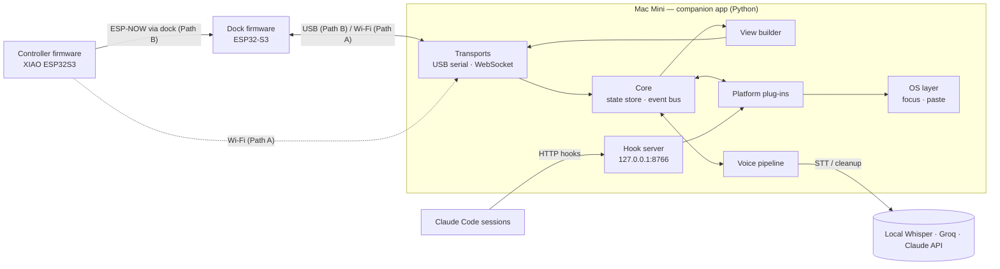
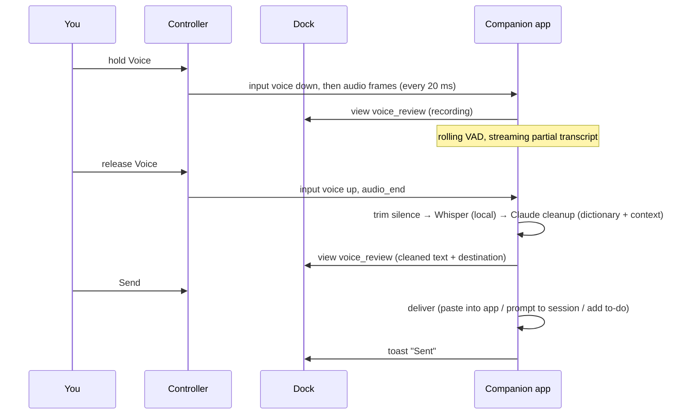

# Software architecture — AI Agent Controller v0

Nov 11, 2026. How the code is organized across the three programs, how they talk, and what gets built first. The hardware plan lives in [the blueprint](agent-controller-v0-blueprint.md); this doc is the code plan.

## 1. Principles

1. **The computer does the thinking; the devices are thin.** All agent state, speech-to-text, AI calls and platform logic live in the companion app. The dock draws what it's told and reports input; the controller reports input and streams audio. Firmware stays small and rarely needs reflashing.
2. **One protocol, any transport.** USB serial, Wi-Fi WebSocket and ESP-NOW all carry the same messages, so the latency comparison is a setting, not a rewrite.
3. **Fail safe.** If the device is disconnected or slow, Claude Code falls back to its normal on-screen permission prompt. Nothing is ever approved or sent without a deliberate press.
4. **Build without hardware first.** A fake device and an on-screen simulator let us build and test almost everything before the parts arrive.
5. **Mac first, Windows second.** Everything is Python and C++. The few OS-specific pieces (focusing windows, pasting text) sit behind one small interface.

## 2. The three programs



| Program | Language | Runs on | Job |
|---|---|---|---|
| **Companion app** | Python 3.11+ (asyncio) | Mac Mini (primary), Windows laptop | Tracks every agent session, answers hooks, runs the voice pipeline, decides what the screen shows, talks to both devices |
| **Dock firmware** | C++ (Arduino core on ESP-IDF, LVGL 9) | ESP32-S3 N16R8 | Draws screens from view messages, plays alert sounds, drives the LED, relays the controller over ESP-NOW, talks to the Mac over USB or Wi-Fi |
| **Controller firmware** | C++ (Arduino core) | XIAO ESP32S3 | Reads keys, stick and battery, captures and compresses mic audio, sleeps between uses |

## 3. Code layout in the repo

```
agent-controller/
├── firmware/                       PlatformIO project (one config, several targets)
│   ├── platformio.ini              envs: dock, controller, sim (runs the UI on the Mac)
│   ├── lib/
│   │   ├── protocol/               message types + framing, shared by every target
│   │   └── ui/                     LVGL screens, shared by dock and sim
│   ├── src/dock/                   transports, ESP-NOW relay, audio out, LED, display driver
│   ├── src/controller/             input, mic, battery, sleep, transports
│   └── src/sim/                    SDL window + keyboard → same UI and protocol
├── software/companion-app/
│   ├── pyproject.toml
│   ├── companion/
│   │   ├── __main__.py             `python -m companion`
│   │   ├── config.py               ~/.agent-controller/config.toml; API keys in the OS keychain
│   │   ├── core/                   event bus, state store, intents (what a button press means right now)
│   │   ├── protocol/               message dataclasses, JSON + binary framing (mirrors firmware/lib/protocol)
│   │   ├── transports/             base.py, serial_usb.py, websocket.py
│   │   ├── devices/                dock and controller sessions, heartbeat, clock sync
│   │   ├── view/                   turns state into screen updates for the dock
│   │   ├── voice/                  capture, vad, stt/(local_whisper, groq), cleanup, dictionary, router
│   │   ├── platforms/              base.py, claude_code/, cursor.py, generic_app.py, …
│   │   ├── hooks/                  local HTTP server for Claude Code hooks
│   │   └── osx/ win/               focus window, paste text, notifications
│   └── tests/
└── tools/
    ├── fake_device.py              terminal stand-in for dock + controller (keyboard = keys/stick)
    └── latency/                    timing harness for the USB vs Wi-Fi comparison
```
The original v0 `main.py` was ported to `platforms/claude_code/managed.py` in M1 and removed (it's in git history).

## 4. Companion app internals

A single asyncio process. Everything flows through one **state store**; the dock never computes anything itself.

```
inputs (keys, stick, audio, hooks, platform events)
    → event bus
    → reducers update the State store
    → view builder diffs the new screen against what the dock shows
    → transport sends only the change
```

**State store** (plain dataclasses, one source of truth):
- `sessions`: id, platform, name, project folder, status (`working | waiting | done | error | idle`), last activity, pending approval
- `focus`: which session is selected, which screen is showing
- `voice`: `idle → recording → transcribing → review → sending`, with the draft text
- `devices`: connected, path in use (USB / Wi-Fi / ESP-NOW), battery, signal, firmware version
- `usage`: API spend and usage meters, when a platform reports them

**Intents.** A key press means different things on different screens. A table in `core/intents.py` maps *(screen, input)* to an action. This is the only place button behavior is defined (section 6).

**Hook server.** A small HTTP server on `127.0.0.1:8766`, reachable only from this computer. Claude Code POSTs hook events to it (section 8).

**Concurrency rule.** Slow work (speech-to-text, LLM calls, OS automation) runs in worker threads so the event loop keeps answering heartbeats and inputs within milliseconds.

## 5. Protocol v1

**Envelope.** Every message carries `"v": 1` and a type field `"t"`. Device→Mac input messages also carry a sequence number (`seq`) and the device's milliseconds since boot (`ts`); the Mac acknowledges inputs, so a dropped or duplicated press is detected.

**Framing.** One frame format everywhere:

| Transport | JSON messages | Audio |
|---|---|---|
| WebSocket (Path A) | text frames | binary frames |
| USB serial (Path B) | COBS-encoded packets: `[kind:u8][payload]`, kind 1 = JSON, 2 = audio | same packets, kind 2 |
| ESP-NOW (controller → dock) | ≤ 250-byte packets, same `[kind][payload]` layout; the dock forwards them unchanged | IMA-ADPCM chunks, 20 ms each |

**Audio frame header (binary):** `stream_id:u8, seq:u16, codec:u8, samples:u16`, then data. 16 kHz mono. Raw PCM over Wi-Fi/USB, IMA-ADPCM over ESP-NOW.

**Handshake.**
1. The device sends `hello`: device type, firmware version, which transports it supports, screen size.
2. The Mac answers `welcome`: protocol version, the clock offset, and the full current screen.

**Heartbeat.** A ping every 500 ms. After 2 s of silence both sides treat the link as down: the dock shows "disconnected", the Mac stops routing approvals to the device and lets Claude Code show its normal prompt.

**Screen updates.** The Mac sends `view` messages that name a screen template plus its data (e.g. `{"t":"view","screen":"home","rows":[…],"sel":2}`), and small `patch` messages for single changes (status color, LED, transcript text). The dock never builds screens from logic, only from these.

The full message list lives in `firmware/lib/protocol/messages.h` and `companion/protocol/messages.py`. The two are kept in sync by a shared test that encodes and decodes every message on both sides.

## 6. Screens and controls

| Screen | Shows | Stick ←/→ | Stick ↑/↓ | Click | Cancel | Voice (hold) | Send |
|---|---|---|---|---|---|---|---|
| **Home** | Every session: status, name, last activity; usage header | Switch filter (all / waiting / done) | Move selection | Open detail | — | Record a prompt for the selected session | Bring the selected session's window to the front |
| **Detail** | Last output, current tool, step | Previous / next session | Scroll | Back to Home | Back to Home | Record a prompt for this session | Bring window to front |
| **Approval** (pops up when an agent asks) | Tool, command or file, options (Approve / Approve for session / Reject / Ask in terminal) | Change option | Change option | Confirm option | Reject | — | Confirm option |
| **Voice review** | Live transcript, then cleaned text and its destination | Change destination | Scroll text | — | Discard draft | Hold again to edit by voice | Deliver it |
| **Toast** (overlay) | "Sent", "Approved", "Disconnected" | — | — | — | — | — | — |

- **Flick detection:** a direction counts when the stick passes 60% of its travel and returns below 30% (hysteresis), so one flick is one step. Holding past 60% for 400 ms auto-repeats.
- **Alert sound:** plays when a session becomes WAITING. It is muted while you're recording and can be switched off.
- **LED:** blue = working, amber pulse = something is waiting, green flash = done, red = error or disconnected, white = recording.

## 7. Voice pipeline



- **Speech-to-text:** behind one interface, `stt.transcribe(audio, vocab) -> text`, with three implementations: `mlx_whisper` (Mac, Apple Silicon), `faster_whisper` (Windows/CPU) and `groq` (cloud fallback). The config picks the order.
- **Cleanup contract:** input = raw text, mode (`prompt | message | email`), dictionary terms, context (frontmost app; selected session and project). Output = cleaned text only. Rule: never add content, only fix it.
- **Dictionary:** `~/.agent-controller/dictionary.yaml` with `terms:` (correct spellings) and `fixes:` (mis-hearing → correct). It is fed to both Whisper (as a vocabulary prompt) and the cleanup step.
- **Privacy:** audio stays in memory and is never written to disk unless debug recording is on.

## 8. Platform plug-ins

```python
class Platform(Protocol):
    name: str
    caps: set[Cap]                       # STATUS, APPROVE, PROMPT, FOCUS
    async def start(self, bus) -> None: ...                # begin watching; publish session events to the bus
    async def send_prompt(self, sid: str, text: str) -> None: ...
    async def decide(self, sid: str, request_id: str, choice: Choice) -> None: ...
    async def focus(self, sid: str) -> None: ...
```

### Claude Code (first and deepest)

Two kinds of session:

| | **Attached** (your normal terminal sessions) | **Managed** (started by the companion app) |
|---|---|---|
| How | Claude Code **HTTP hooks** point at `http://127.0.0.1:8766/hooks/claude` | Companion app runs `claude` with stream-JSON in and out (`managed.py`, ported from the v0 `main.py`; permissions are not skipped) |
| Status | HTTP hooks: `UserPromptSubmit`, `PreToolUse`, `PostToolUse`, `Notification` (`permission_prompt`, `agent_needs_input`, …), `Stop`, `StopFailure`, `SessionEnd`. `SessionStart` only accepts command hooks, so it uses the report script below | From the stream |
| Approvals | **`PermissionRequest` hook:** the companion app holds the HTTP request open, shows the Approval screen and replies `{"hookSpecificOutput":{"hookEventName":"PermissionRequest","decision":{"behavior":"allow"}}}` (or `deny` with a `message`) when you press. If the device is disconnected, you pick **Ask in terminal**, or nobody presses anything within `approval_timeout_s` (120 s), it replies with **no decision**, and Claude Code shows its normal terminal prompt. The terminal waits while the hook is open, which is why that option exists. **Approve for session** returns `updatedPermissions` = the request's `permission_suggestions` with `destination: "session"`, so nothing is written to settings files. | Same hooks |
| Voice prompts | Focus that session's terminal tab, paste, press Enter (OS layer) | Write to the session's input stream |
| Focus | An async `SessionStart` **command** hook (`python -m companion.hooks.report`) reports the session's terminal app (`TERM_PROGRAM`, macOS bundle id) and tab (TTY); the OS layer brings that exact tab forward (Terminal and iTerm2 by TTY, other apps by bundle id) | — |

Hooks are installed into `~/.claude/settings.json` by `python -m companion install-hooks`, which backs up the file first and is undone by `uninstall-hooks`.

The plug-in only uses fields documented in Claude Code's hooks reference: `session_id`, `cwd`, `hook_event_name`, `tool_name`, `tool_input`, `notification_type`, `message`, `prompt`. Recheck it if Claude Code updates.

### Others
- **`generic_app`**: FOCUS + PROMPT for any app by name (Claude desktop, ChatGPT, Grok, Cursor chat, browser tabs for Duet, Dots and Muse).
- **`cursor`**: adds start/stop status from Cursor's hooks once we confirm which events fire.

## 9. OS layer

| Function | macOS | Windows |
|---|---|---|
| Bring an app/tab to the front | AppleScript via `osascript` (Terminal and iTerm2 tabs by TTY) | `pywinauto` / Win32 `SetForegroundWindow` |
| Paste text | Save clipboard → set text → Cmd-V via Quartz events → restore clipboard (needs Accessibility permission) | Clipboard + `SendInput` Ctrl-V |
| Frontmost app (voice context) | `NSWorkspace` via `pyobjc` | `GetForegroundWindow` |
| Keychain for API keys | `keyring` (macOS Keychain) | `keyring` (Credential Manager) |

## 10. Firmware structure

**Dock (ESP32-S3, two cores):**

| Task | Core | Rate | Does |
|---|---|---|---|
| `ui` | 1 | 33 ms | LVGL timer + applying `view`/`patch` |
| `link` | 0 | event-driven | Active transport (USB CDC first, Wi-Fi fallback), heartbeat |
| `relay` | 0 | event-driven | ESP-NOW receive from the controller → forward to the Mac |
| `audio` | 0 | event-driven | Plays alert sounds from flash through I2S |
| `led` | 1 | 20 ms | LED animations |

The frame buffers go in PSRAM; SPI to the display runs over DMA at 20 MHz first, then 40 MHz. Settings (Wi-Fi network, preferred path, the controller's MAC address) are stored in NVS flash.

**Controller (XIAO ESP32S3):**
- `input` task: 5 ms key debounce, 100 Hz stick sampling, calibrated center and deadband.
- `mic` task: I2S DMA → mix to mono → PCM or ADPCM → 20 ms frames.
- `link` task: Wi-Fi or ESP-NOW.
- **Power:** light sleep after 30 s idle, waking on any key. The radio stays off until a key is pressed (Path B) or keeps a low-rate connection (Path A). The battery is read every 30 s.

**Pairing:** the first time the controller sits on the dock, the dock shows a code. Pressing Send stores each other's MAC address for ESP-NOW.

## 11. Testing

| Level | What | Runs |
|---|---|---|
| Unit | Protocol encode/decode (Python and C++, same fixtures), intents table, flick detection, state reducers, cleanup prompt contract | `pytest`, PlatformIO `native` tests, on every push (GitHub Actions) |
| Fake device | `tools/fake_device.py` speaks the protocol from the terminal: arrow keys = stick, `c`/`v`/`s` = Cancel/Voice/Send, Mac mic = controller mic | By hand, before hardware |
| UI simulator | `pio run -e sim`: the real LVGL screens in a desktop window on the Mac | By hand |
| Hardware | Test plan in blueprint §10, results in `tests/` | When parts arrive |

## 12. Build order (most of it before parts arrive)

| Milestone | Needs hardware? | Done when |
|---|---|---|
| **M0** Restructure the companion app into the package above; protocol module; fake device | No | Fake device connects over WebSocket and shows sessions |
| **M1** Claude Code plug-in: install hooks, live status, approvals answered from the fake device | No | Approve a real Claude Code edit from the fake device; disconnecting falls back to the terminal prompt |
| **M2** Voice pipeline using the Mac's mic | No | Hold a key, speak, cleaned text pastes into Claude, ChatGPT and Cursor |
| **M3** LVGL screens in the simulator | No | All five screens driven by the companion app |
| **M4** Dock firmware on the real board (USB + Wi-Fi) | Dock parts | Same screens on the real display over both paths |
| **M5** Controller firmware (Wi-Fi, then ESP-NOW via dock) | Controller parts | Real keys, stick and mics drive everything |
| **M6** Latency shoot-out, then shell CAD and print | All parts | `tests/latency-shootout.md` filled in; assembled device |

## 13. Decisions made here (defaults; change any)

| Decision | Choice | Why |
|---|---|---|
| Firmware toolchain | **PlatformIO** (VS Code or command line) instead of Arduino IDE | Two boards plus a simulator in one project, pinned library versions, buildable from Claude Code |
| UI library | LVGL 9 | Built-in ST7796 driver; runs in the desktop simulator |
| Screens | Fixed templates filled by `view` messages | Fast and simple; SlashVibe-style streamed custom screens can come later |
| Claude Code integration | HTTP hooks + `PermissionRequest` | Approvals without wrapping the terminal; falls back safely |
| STT | `mlx-whisper` locally first, Groq as fallback | Fast on Apple Silicon, private |
| Python | asyncio, dataclasses, `websockets`, `pyserial-asyncio`, `aiohttp` | Small, cross-platform |
| Secrets | OS keychain via `keyring` | Never in the repo or config files |
