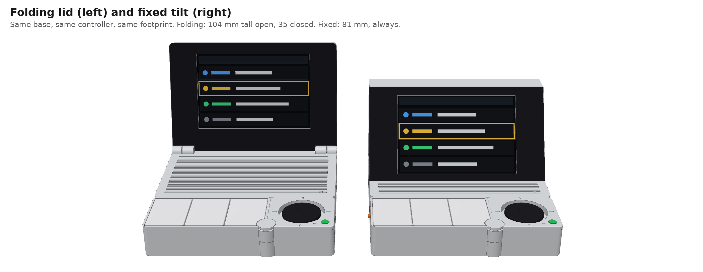
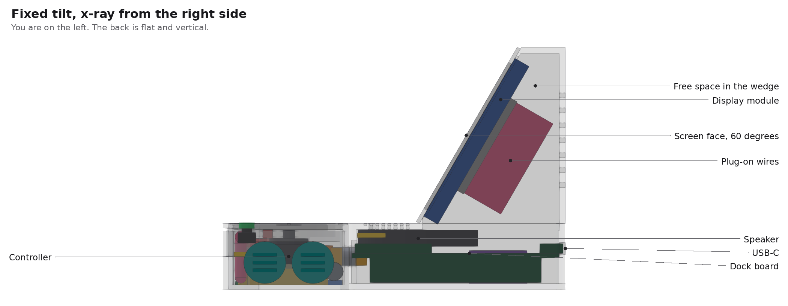

# Option: fixed-tilt screen (rev 3b)

Written 2026-11-18. **This is an option, not the chosen design.** The plan of record is still the folding lid in [blueprint rev 3](agent-controller-v0-blueprint.md). Nico asked for a full mock-up of a version where the screen is always tilted and never folds, to compare the two.

- Model: [`hardware/cad/rev3b-fixed-tilt/concept_tilt.py`](../hardware/cad/rev3b-fixed-tilt/concept_tilt.py). It reuses the rev 3 controller and parts.
- Renders: [`hardware/renders/2026-11-18-rev3b-fixed-tilt/`](../hardware/renders/2026-11-18-rev3b-fixed-tilt/).
- The automatic fit check passes: no two parts overlap, with the block in line and swung out.

---

## What it is

- **Base and controller:** unchanged. Same parts, same positions, same 124 × 112 mm footprint.
- **Screen:** in a rigid wedge on the back of the base, fixed at 60° from the desk.
- **Wedge:** one printed part, 124 mm wide, 50 mm deep and 59 mm tall, open into the base underneath. Its back is flat and vertical.
- **Height:** 81 mm, always.

---

## What changes from the folding lid

| | Folding lid (plan of record) | Fixed tilt (this option) |
|---|---|---|
| Height | 104 mm open, 35 mm closed | 81 mm, always |
| Footprint | 124 × 112 mm | 124 × 112 mm |
| Closes flat | Yes | No. The screen is always exposed. |
| Like the reference | Yes: fold-flat is one of its signature features | No |
| Hinge | Two printed knuckles, two M2 pins, a printed stop | None |
| Wires to the screen | 11 or 12 wires flex across the hinge every time the lid moves | They run straight down. Nothing flexes. |
| Display pins | Bent flat; 0.2 mm to spare for the plugs | Left straight. Wires plug on, with room to spare. |
| Lid magnets | Two | None |
| Screen angle | 75° from the desk (one position, set by the stop) | 60° from the desk. Faces a seated person more squarely. |
| Ribbed top | About 58 mm deep, speaker fully under it | A 16 mm strip. The speaker sits half under it; the rest of its sound leaves through slots in the wedge's back. |
| Printed parts for the screen | Lid frame, lid back | One wedge and a flat frame |
| Parts to buy | No change | No change. Two magnets and two M2 screws are left over. |

**Tight spots it removes:** the display-in-the-lid one (blueprint §4.7, item 1).

**Tight spots it keeps:** the battery under the switches, the dock board's length, the dock board's pins, and the controller's status light. Those are in the base and the controller, which don't change.

---

## Where each part goes

Only the parts that differ from blueprint §4.7:

| Part | Place |
|---|---|
| Display | On the wedge's tilted face, behind a flat frame |
| Display wires | Plugged onto the straight pins; they drop into the base |
| Speaker | Moved forward, under the front strip (centre 23 mm behind the base's front face) |
| Sound and air slots | Seven slots in the wedge's back wall |
| Dock board, amplifier, charge contacts, magnets, status light | Same places as the folding version |

---

## How to decide

- The plan already prints one hinge knuckle as a test piece before the full shell (M7b). If that hinge is flimsy, or the wires bind, this option is ready.
- Choosing this option now would also be fine. It is the easier and sturdier build. The cost is the fold-flat look.
- Either way, nothing already bought changes.
